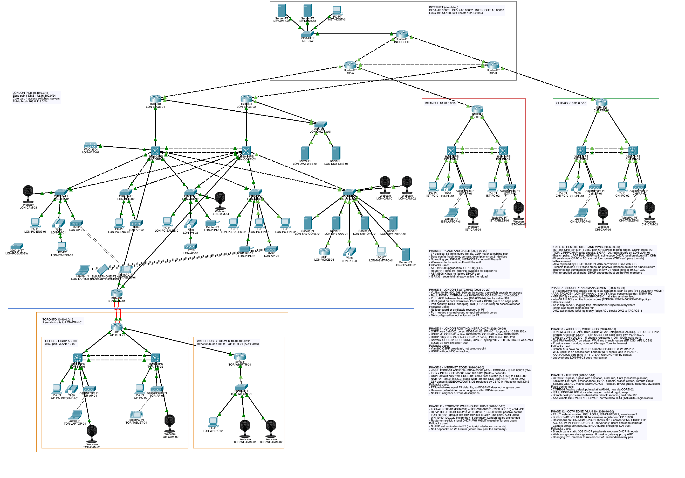

# bosphorus-enterprise-net

A four-site enterprise network built and tested in **Cisco Packet Tracer 9.0.1**: a London headquarters with dual ISPs, a DMZ and campus redundancy, plus regional sites in Istanbul, Chicago and Toronto connected over IPsec VPNs and a private circuit. Toronto also has a RIPv2 warehouse, and every site has a CCTV zone of IoT cameras registered to one London server.

The scenario is fictional. Every design choice (which routing protocol runs where, how failover works, what each zone may reach) is justified in the docs and verified by a written test plan, including tests that deliberately break things.

> **Status:** built and tested. 29 tests: 18 pass, 6 pass with a documented deviation, 4 not run, 1 not possible in Packet Tracer ([results](#test-results)).



---

## Topology at a glance

```
                        [INET-CORE AS65000]──(192.0.2.0/24 "internet")
                         /               \
                [ISP-A AS65001]────────[ISP-B AS65002]
                 /        \               /        \
          eBGP  /     IST WAN        eBGP /     CHI WAN
               |          |              |          |
        [LON-EDGE-01]        [LON-EDGE-02]      [CHI-RTR-01]    
           |    \   DMZ (HSRP)   /   |             /     \
           |     [LON-DMZ-SW01]      |      [CHI-SW-01]=[CHI-SW-02]
           |      WEB   DNS          |
        [LON-CORE-01]===Po1 LACP===[LON-CORE-02]   [IST-RTR-01]
           |   \                        /  |        /     \
           |  [LON-ACC-01..04]  [LON-SRV-SW01]  [IST-SW-01]=[IST-SW-02]
           |   80 desks, WLC + 4 APs, servers, CME
        [LON-WAN-01]═══2 serial circuits═══[TOR-RTR-01]───RIPv2───[TOR-WH-RTR-01]
                                             /     \                   |
                                     [TOR-SW-01]=[TOR-SW-02]     [TOR-WH-SW-01]
                                                                  warehouse

Branch pairs (=): two 3650s, LACP bundle, HSRP, one uplink each
CCTV:      VLAN 90 at every site + the warehouse, 12 IoT webcams -> LON-SRV-IOT-01
Overlays:  GRE/IPsec Tunnel0  LON-EDGE-01 <-> IST  (primary)
           GRE/IPsec Tunnel1  LON-EDGE-02 <-> IST  (backup)
           GRE/IPsec Tunnel2  LON-EDGE-01 <-> CHI  (primary)
           GRE/IPsec Tunnel3  LON-EDGE-02 <-> CHI  (backup)
```

| Site | Staff | Role | WAN | Routing |
|---|---|---|---|---|
| **London (LON)** | 80 | HQ: redundant core, 4 access switches, servers, DMZ, Wi-Fi, voice, internet edge | ISP-A primary, ISP-B backup | OSPF area 0, eBGP |
| **Istanbul (IST)** | 30 | Regional office, redundant switch pair | ISP-A + GRE over IPsec to both London edges | OSPF area 1 |
| **Chicago (CHI)** | 36 | Branch office, redundant switch pair | ISP-B + GRE over IPsec to both London edges | OSPF area 2 |
| **Toronto (TOR)** | 36 | Acquired site on a legacy design, redundant switch pair; stub warehouse (TOR-WH) behind TOR-RTR-01 | Two private serial circuits to HQ, no local internet | EIGRP AS 100, redistributed at HQ; RIPv2 at the warehouse, redistributed one way at TOR-RTR-01 |

Every site has user, voice, corporate Wi-Fi, guest Wi-Fi and CCTV VLANs, and no single switch failure takes a site down. Switch ports and DHCP scopes are sized for all 182 staff; Packet Tracer holds a representative sample of endpoints, and the branch AP layout is demo-scale rather than a production RF design (see [sizing](docs/design-plan.md#4-sizing)).

## What's covered

| Area | Features |
|---|---|
| Switching | VLANs, 802.1Q trunks (native VLAN 999, DTP off), VTP transparent, Rapid PVST+ with per-VLAN root placement, LACP EtherChannel |
| L2 security | PortFast + BPDU guard, root guard, port security, DHCP snooping, DAI (configured; PT doesn't enforce it), rogue-switch attack demo |
| Routing | Inter-VLAN routing on L3 switch SVIs, OSPF multi-area with MD5 and summarisation, EIGRP, RIPv2 at a stub warehouse, one-way redistribution kept inside a summary ([ADR 0016](docs/adr/0016-rip-warehouse-second-redistribution.md)), eBGP with longest-match inbound engineering (PT has no iBGP, prefix-lists or route-maps) |
| Redundancy | HSRP at every site, redundant switch pairs at the branches, dual ISP failover with symmetric NAT, backup VPN tunnels for both GRE branches, dual Toronto circuits |
| WAN / VPN | GRE over IPsec with OSPF, PPP with CHAP (an ASA branch was planned but PT's ASA can't complete IPsec with IOS, [ADR 0007](docs/adr/0007-chicago-router-not-asa.md)) |
| Edge security | Stateful firewall (CBAC + ACLs, [ADR 0015](docs/adr/0015-cbac-not-zbf.md)), PAT and static NAT, DMZ |
| Internal security | Inter-VLAN ACL policy matrix, AAA (TACACS+ / RADIUS), SSH-only management, NTP, Syslog, SNMP |
| Services | DHCP, DNS, HTTP, email, TFTP config backups |
| Wireless | WLC-3504 with lightweight APs in London, autonomous APs at the branches; WPA2-Enterprise (RADIUS) corporate SSID in London, PSK guest SSID; branch guests isolated |
| Voice / QoS | CME IP telephony for all four sites, MQC marking and queuing on every WAN edge |
| CCTV / IoT | VLAN 90 at every site, 12 wired IoT webcams registering to an IoT server in London across the VPNs, EIGRP and RIP; cameras may reach only that server (TCP 31000) and no user VLAN can reach them |

## Repository map

| Path | Contents |
|---|---|
| [`docs/design-plan.md`](docs/design-plan.md) | Full design: requirements, every subsystem, redundancy, build phases |
| [`docs/addressing-plan.md`](docs/addressing-plan.md) | VLANs, subnets and every interface IP |
| [`docs/cabling-plan.md`](docs/cabling-plan.md) | Device models, modules and port-to-port cabling |
| [`docs/build-guide.md`](docs/build-guide.md) | Phase-by-phase build steps with verification commands |
| [`docs/test-plan.md`](docs/test-plan.md) | 29 tests, including failure and attack scenarios, with results |
| [`docs/adr/`](docs/adr/) | 16 architecture decision records |
| [`docs/pt-support-matrix.md`](docs/pt-support-matrix.md) | What Packet Tracer 9 does and doesn't support, verified hands-on |
| [`docs/lab-credentials.md`](docs/lab-credentials.md) | Every lab secret in one place |
| [`configs/`](configs/) | Every device's configuration, by site, sectioned by build phase |
| [`configs/servers/`](configs/servers/) | Server, WLC, phone and endpoint settings (GUI-configured) |
| [`diagrams/`](diagrams/) | Mermaid diagrams: sites, Layer 2, branch layout, routing, firewall, VPN, wireless, physical view, shared services |
| [`phase0/`](phase0/) | Feature-validation lab and procedure |
| [`pkt/`](pkt/) | The Packet Tracer file, plus a checkpoint per build phase |
| [`screenshots/`](screenshots/) | Build evidence by phase, test evidence by test ID |

## Build progress

| Phase | Scope | Status |
|---|---|---|
| 0 | Packet Tracer feature validation | ✅ |
| 1 | Design documents, configs and diagrams | ✅ |
| 2 | Place and cable devices | ✅ |
| 3 | London switching | ✅ |
| 4 | London routing and first-hop redundancy | ✅ |
| 5 | Internet edge (BGP, NAT, firewall, DMZ) | ✅ |
| 6 | Remote sites and VPNs | ✅ |
| 7 | Security and management | ✅ |
| 8 | Wireless, voice, QoS | ✅ |
| 9 | Testing | ✅ |
| 10 | Documentation | ✅ |
| 11 | Toronto warehouse on RIPv2 | ✅ |
| 12 | CCTV zone (VLAN 90, IoT cameras) | ✅ |

## Test results

Full procedures, evidence and deviations are in [test-plan.md](docs/test-plan.md).

| Result | Tests |
|---|---|
| ✅ Pass (18) | Core switch, EtherChannel, branch switch and Toronto circuit failures; Chicago VPN and its backup tunnel; CHAP and OSPF authentication; SSH-only management with TACACS+ and local fallback; Wi-Fi credentials; voice calls to every site; NTP and syslog; unsolicited inbound traffic; DMZ isolation; BPDU guard; BGP advertisements; camera registration from every site; camera isolation |
| ⚠️ Pass with deviation (6) | ACL policy matrix and guest isolation (London Wi-Fi clients share the management VLAN, a Packet Tracer WLC limitation); ISP-A and Istanbul tunnel failover (needed fixes during testing); DAI (configured, not enforced by PT); RIP warehouse (no RIP authentication in PT) |
| Not run (4) | Rogue DHCP and root guard (already shown in the Phase 0 validation), port security (seen enforcing during the build), QoS under congestion (not modelled reliably by PT; class counters shown instead) |
| n/a (1) | Loop guard: not available in Packet Tracer |

Testing also found and fixed three configuration bugs (a misrouted backup default on LON-CORE-01, wrong TACACS+ client addresses, and a voice VLAN ACL that broke the CME config backup) and two Packet Tracer quirks; details in [test-plan.md](docs/test-plan.md#summary).

## Opening the lab

- Built and tested in **Cisco Packet Tracer 9.0.1 (build 9.0.1.0858)**. Open it with this version or newer; Packet Tracer files are not backward-compatible.
- Credentials in this lab are lab-only and are not used anywhere else.

## Optional: MCP-assisted building

The lab can be built by hand from the docs. Parts of it were automated with [MCP-Packet-Tracer](https://github.com/Mats2208/MCP-Packet-Tracer) (Packet Tracer's script module driven by an AI agent); the build guide notes where the MCP's device catalog differs from the live port names.

> **Note:** the MCP server ran from a Python virtual environment in the project folder (`.venv-packet-tracer-mcp/`, git-ignored), so nothing was installed into the system Python. To recreate it: `python3 -m venv .venv-packet-tracer-mcp`, then `.venv-packet-tracer-mcp/bin/pip install packet-tracer-mcp`, and point your MCP client at `.venv-packet-tracer-mcp/bin/pt-mcp --stdio`.

## Packet Tracer limitations

Packet Tracer implements a subset of IOS. Where a production network would use something PT lacks (VRRP, DMVPN/VTI, SNMPv3, CoPP, UDLD), the design uses the closest supported equivalent and the gap is recorded in [`docs/pt-support-matrix.md`](docs/pt-support-matrix.md). Convergence times measured in PT are not representative of real hardware, and PT 9.0.1 crashed several times on a lab this size (see the matrix).

---

*All company, site and domain names in this project are fictional. Addressing uses RFC 1918 and RFC 5737 documentation ranges; the internal domain uses the reserved `.test` TLD.*

© 2026 Atahan. All rights reserved; shared for viewing as a portfolio project.
