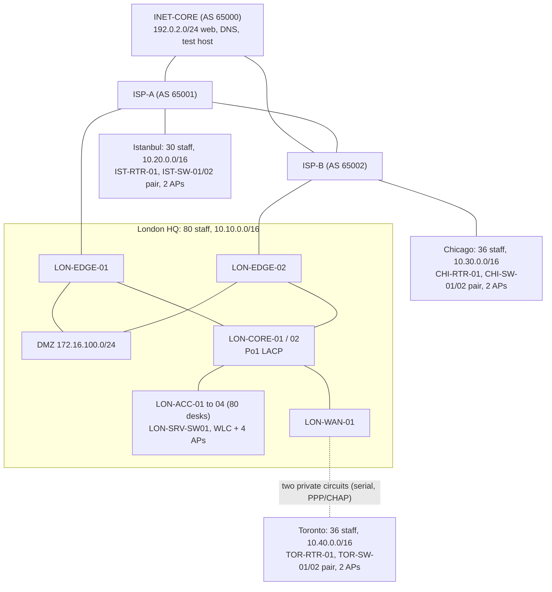
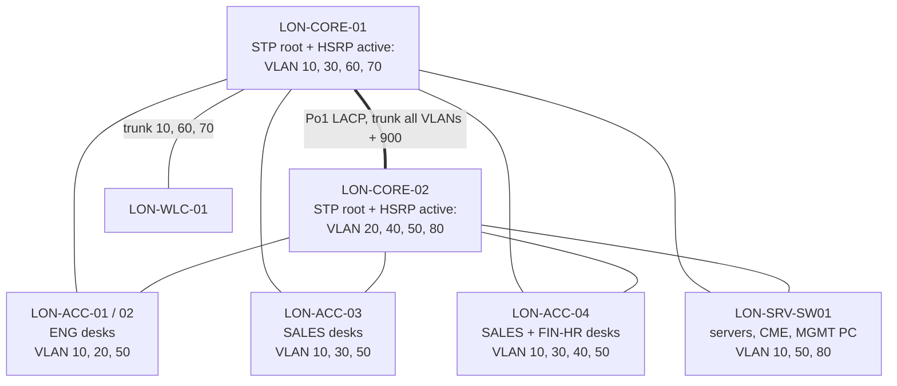
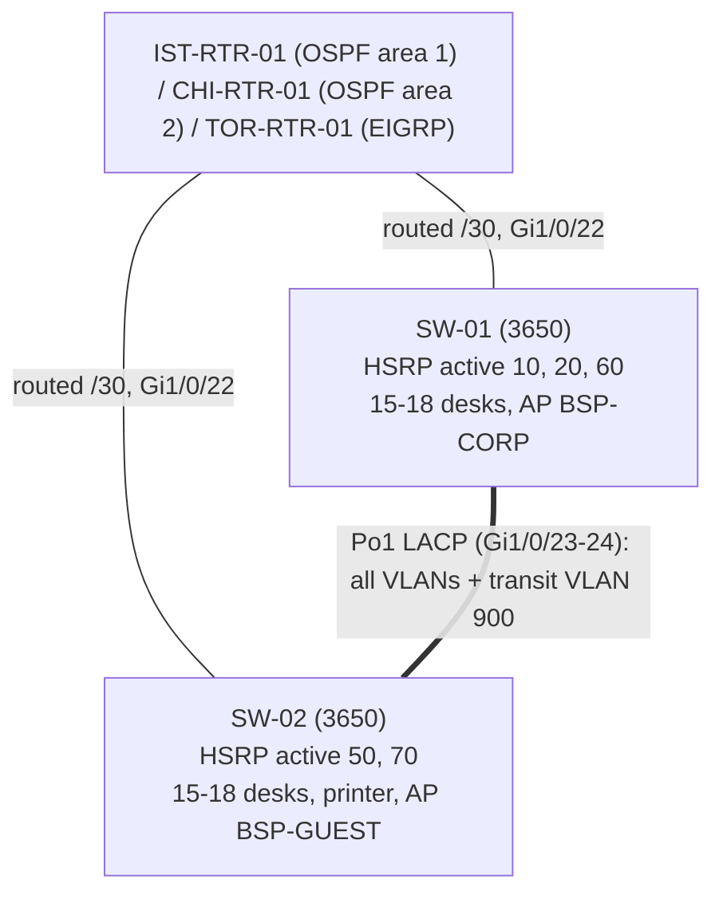
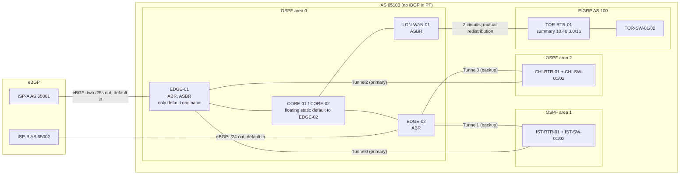
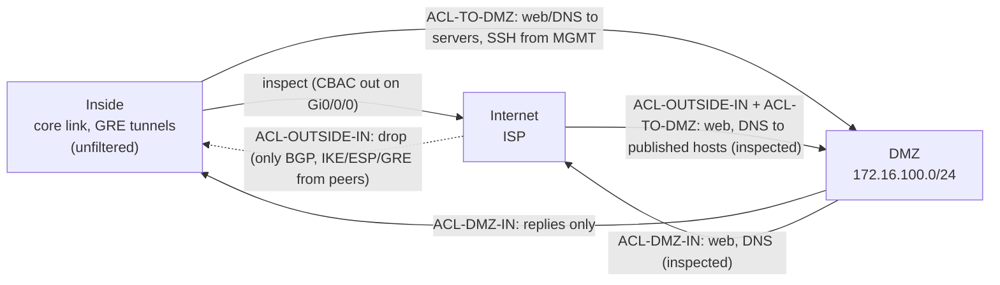
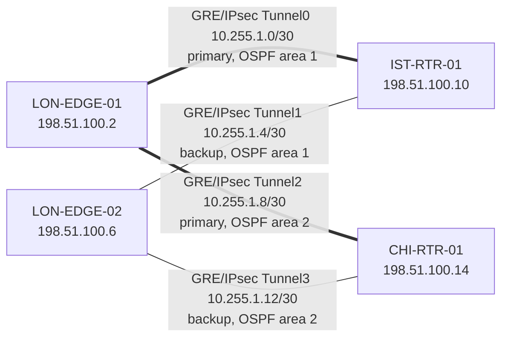
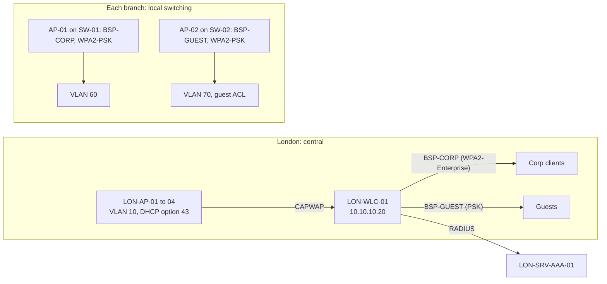
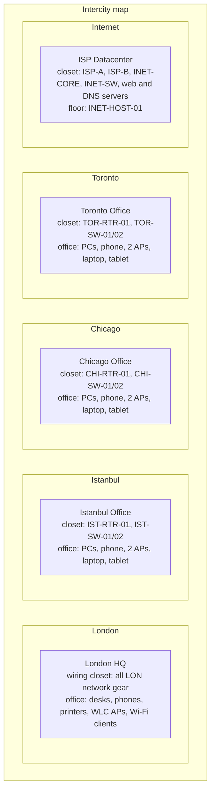
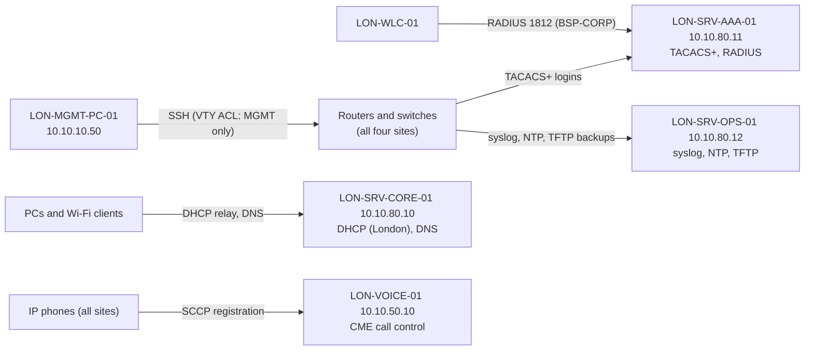

# Diagrams

Mermaid diagrams render directly on GitHub. Addresses and ports are in [addressing-plan.md](../docs/addressing-plan.md) and [cabling-plan.md](../docs/cabling-plan.md).

## 1. Site overview

Port-level cabling is in [cabling-plan.md](../docs/cabling-plan.md). The full Packet Tracer canvas is in [`screenshots/topology/topology-full.png`](../screenshots/topology/topology-full.png); the physical layout is in section 7.

## 2. Layer 2 in London: VLANs, STP roots, HSRP

Every downlink is dual-homed, with root guard on the core side (Packet Tracer has no loop guard, matrix P0-02b). Per VLAN, each access switch forwards on the uplink to that VLAN's root and blocks the other (on LON-ACC-01, VLAN 10 forwards on Gi0/1 and blocks Gi0/2; VLAN 20 the reverse). All trunks: native VLAN 999, DTP off, explicit allowed lists.

## 2b. Branch layout (every branch)

Either switch can fail: the other keeps every gateway (HSRP), its own uplink and its half of the DHCP scopes.

## 3. Routing domains

Summary at the ABRs: `10.10.0.0/16` into areas 1 and 2. The branch subnets reach area 0 unsummarised (matrix B-48). Tunnel costs can't be set in PT (matrix B-40): EDGE-02's cost-1000 core link makes EDGE-01 the primary path.

## 4. Firewall policy (London edge)

CBAC and ACLs replaced the zone-based firewall in Phase 6, because Packet Tracer can't put GRE tunnels in a zone ([ADR 0015](../docs/adr/0015-cbac-not-zbf.md)).

## 5. VPN overlay

## 6. Wireless

As designed, London corporate and guest clients land in VLANs 60 and 70. As built they land in VLAN 10, because Packet Tracer treats the WLC uplink as an access port and can't carry its dynamic interfaces ([matrix B-53](../docs/pt-support-matrix.md)). Branch APs have no RADIUS option, so the branch corporate SSID uses a pre-shared key (B-14).

## 7. Physical view (Packet Tracer)

Packet Tracer computes Wi-Fi range from the Physical view, so each site has its own city, office building and wiring closet. Before this, every device sat in one office and branch clients joined other sites' access points.

## 8. Management and shared services

Every site depends on the London server VLAN (10.10.80.0/24) for these. Device-to-server traffic leaves from the interface facing the server, so branch devices appear at the servers with their router-link addresses (see [servers.md](../configs/servers/servers.md)).

Branch DHCP is local, served by each branch switch pair ([ADR 0009](../docs/adr/0009-local-dhcp-istanbul.md)).
